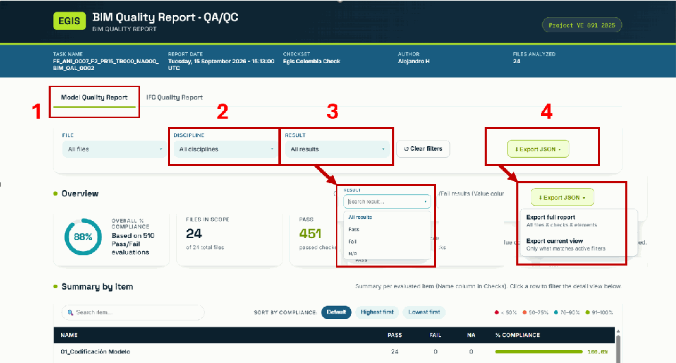
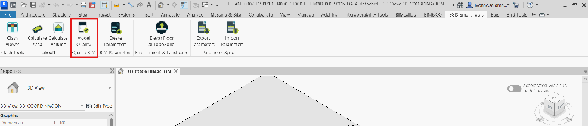
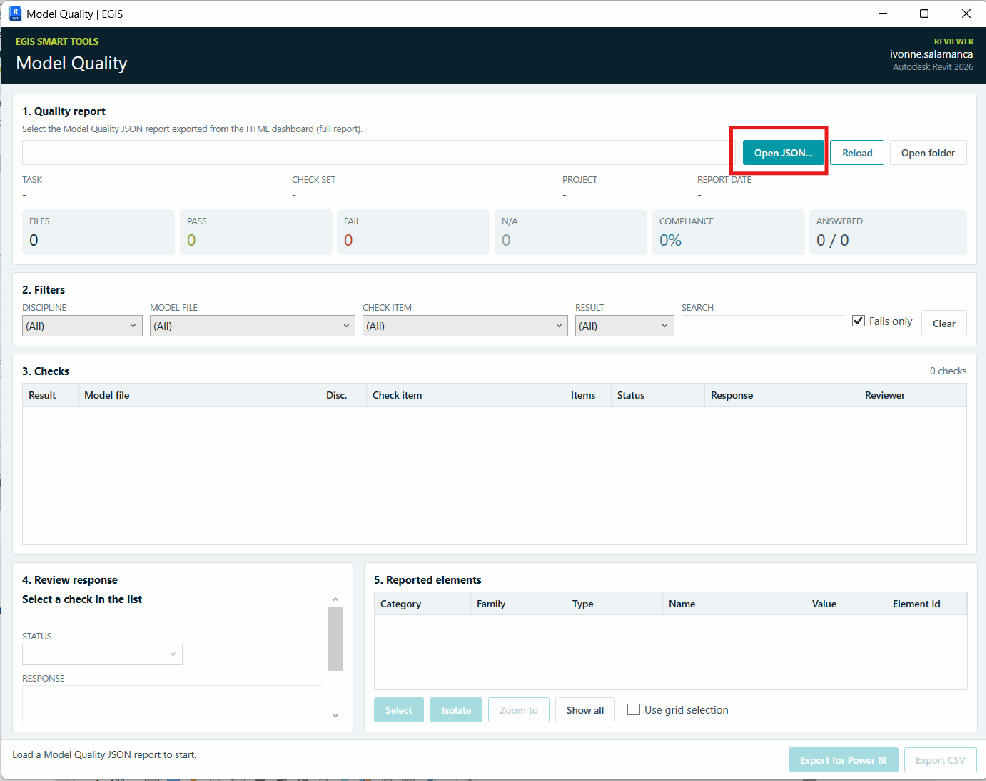
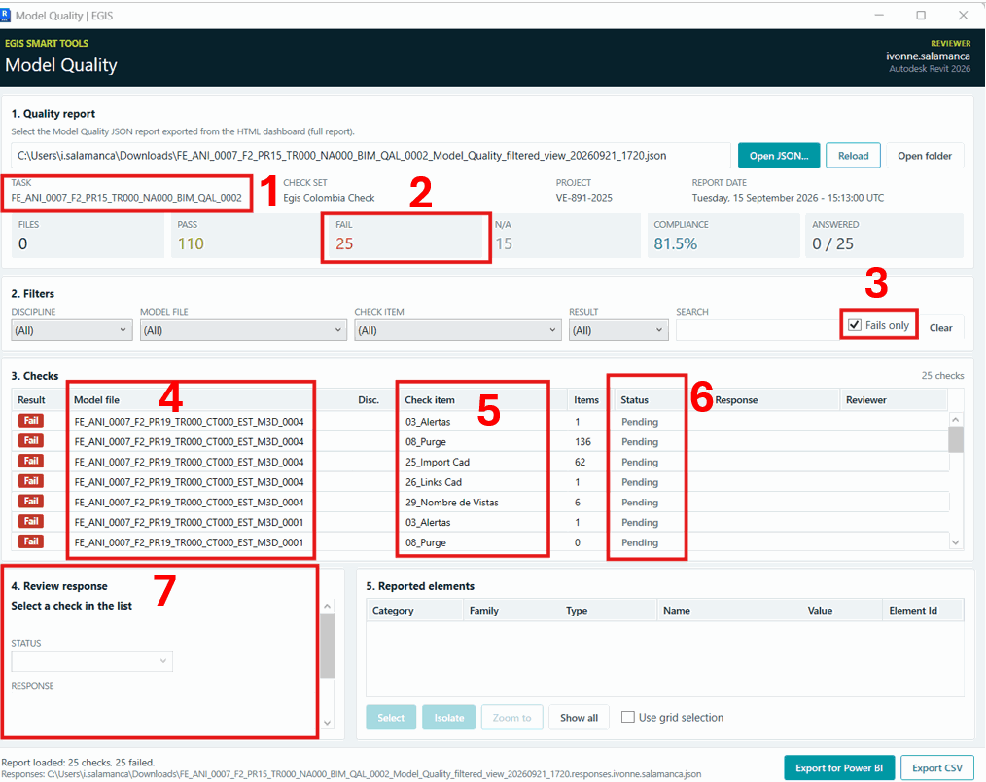
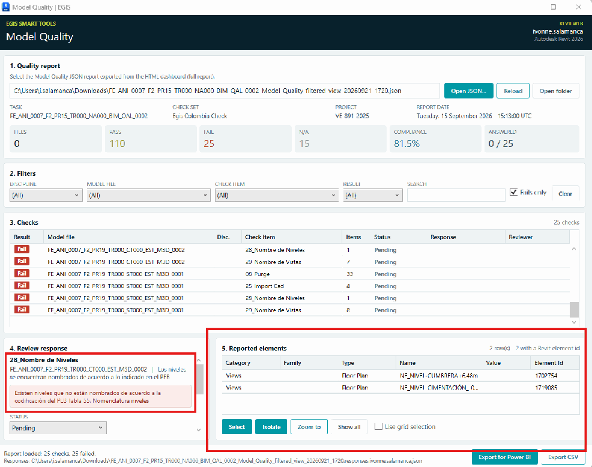
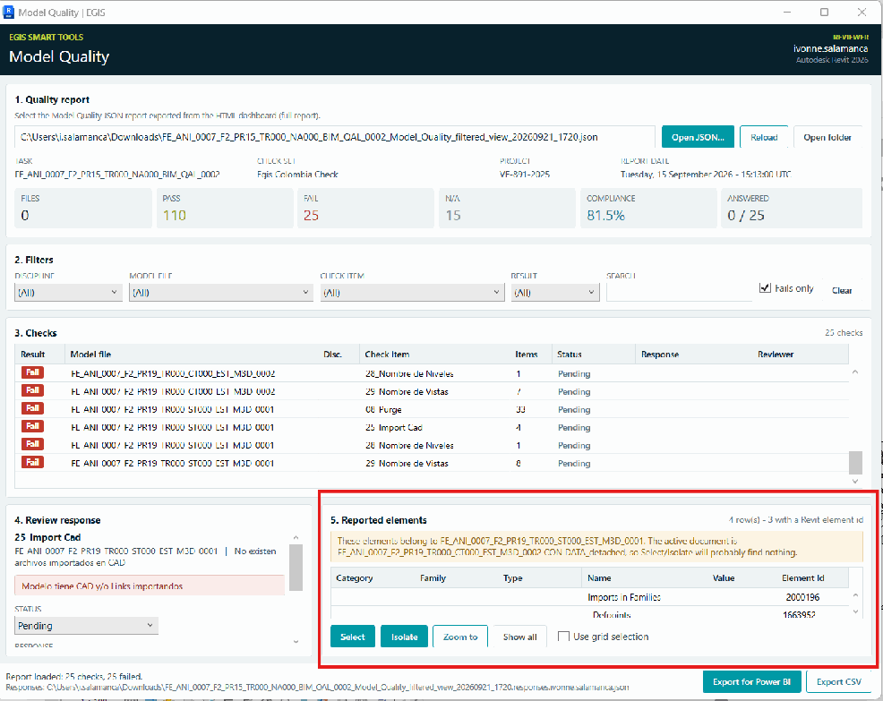
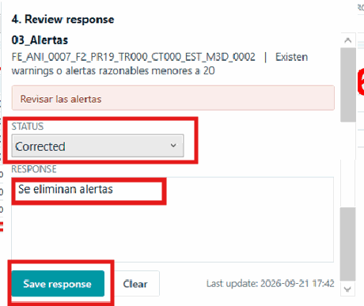
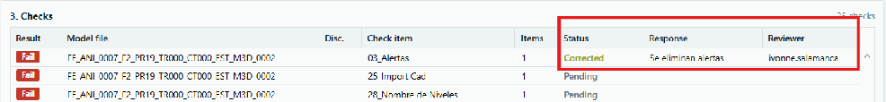

| MODEL QUALITY |
|---|
| Tabla de contenido DESCARGA E INSTALACIÓN Instalación USO DEL PLUGIN 2. GESTION DE OBSERVACIONES MEDIANTE EL PLUGIN 2.1. Visualización de observaciones Modelo abierto corresponde con el hallazgo seleccionado Modelo abierto no corresponde con el hallazgo seleccionado 2.2 Respuesta y cierre de observaciones: 2.3 Exportación de resultados Este plugin permite visualizar, gestionar y dar respuesta a los requerimientos de calidad generados para cada uno de los modelos desarrollados en el proyecto. DESCARGA E INSTALACIÓN El instalador puede descargarse desde la plataforma Autodesk Construction Cloud (ACC) en el siguiente enlace: Archivos - Data Management Autodesk Construction Cloud https://acc.autodesk.com/docs/files/projects/7d7c9a92-3a37-4cb1-8bcc-3446ffb6535d?folderUrn=urn%253Aadsk.wipprod%253Afs.folder%253Aco.KygcLwowQv66… Instalación 1. Descargue el archivo comprimido (.ZIP). 2. Descomprima el contenido en una carpeta local. 3. Ejecute el instalador haciendo doble clic sobre el archivo correspondiente. |

---

Importante: Revit debe estar completamente cerrado antes de iniciar la instalación para garantizar el correcto funcionamiento del complemento.

## USO DEL PLUGIN

1. Exportación del archivo JSON Los reportes de calidad BIM se gestionarán por medio de la plataforma BIM Quality Report · QA/QC. Para cada reporte, se generará un link, donde cada especialista podrá consultar las observaciones generadas a sus modelos tanto en formato RVT como IFC. Para interactuar con el Plugin, es necesario generar dos archivos Json a partir del reporte de calidad.

- Un archivo JSON correspondiente a las observaciones de los modelos RVT.
- Un archivo JSON correspondiente a las observaciones de los modelos IFC.

A continuación se describeel procedimiento para exportar estos reportes en formato JSON.

1. Al abrir el link del reporte, se encontrará con la plataforma que se muestra en la imagen. 2. En el campo identificado con el número 1, seleccionar el tipo de reporte que se desea exportar:

- Model Quality Report para la validación de modelos RVT.
- IFC Quality Report para la validación de modelos IFC.

Nota: Aunque existen dos tipos de reporte, la atención y corrección de las observaciones se realiza desde el modelo de Revit. 3. En el segundo campo,filtrar la disciplina que desea revisar. 4. En el tercer campo, seleccionar el estado de los resultados:

- Pass: elementos que cumplen los criterios de calidad.
- Fail: elementos que presentan observaciones.

- N/A: elementos no aplicables para la disciplina evaluada.

Para el proceso de subsanación de observaciones, se recomienda filtrar únicamente los elementos con estado Fail.

---

5. En el cuarto paso, seleccionar el alcance de la exportación:

- Reporte completo.
- Reporte filtrado según los criterios definidos en los pasos anteriores.

Una vez haga clic en la opción seleccionada, automáticamente se generará el archivo JSON y se guardará en la carpeta de descargas.

## 2. GESTION DE OBSERVACIONES MEDIANTE EL PLUGIN

Una vez generados los archivos JSON, estos deben gestionarse individualmente.. 1. En Revit, ubique la pestaña "Egis Smart Tools" y seleccione el ícono "Model Quality"

2. Al hacer clic, se desplegará la ventana principal del plugin: 3. Seleccione la opción "Open JSON" y cargue el archivo correspondiente al reporte que se desea atender.

4. Una vez cargado el reporte, se visualizará la siguiente información::

---

1. Nombre del reporte de calidad cargado. 2. Numero de elementos que presentan observaciones 3. Casilla para mostrar únicamente los elementos con errores. 4. Nombre del modelo donde se encuentra el hallazgo 5. Ítem o validación que presenta el error. 6. Campo Status, correspondiente al estado de atención del hallazgo. 7. Campo Review Response, donde se puede consultar el detalle del hallazgo y registrar la respuesta correspondiente.

### 2.1. Visualización de observaciones

Al seleccionar una fila del reporte en el apartado 3.Checks, pueden presentarse dos escenarios:

**Modelo abierto corresponde con el hallazgo seleccionado**

Si el archivo abierto en Revit corresponde al modelo asociado al hallazgo seleccionado:

- Se mostrará la descripción del error.
- Se visualizará el detalle de los elementos reportados.

---

**Modelo abierto no corresponde con el hallazgo seleccionado**

Si el archivo abierto no corresponde al modelo asociado al hallazgo:

- Se mostrará un mensaje indicando que el modelo abierto no coincide con la observación seleccionada.
- No será posible visualizar el detalle de los elementos reportados hasta abrir el modelo correcto.

---

### 2.2 Respuesta y cierre de observaciones:

Una vez se iniciela atención de las observaciones, en la casilla 4 se debe: 1. Actualizar el campo Status con el estado correspondiente. 2. Registrar los comentarios o aclaraciones necesarias en el campo Response. 3. Hacer clic en "Save Response" para guardar la información.

---

Importante: La acción "Save response" permitirá conservar las respuestas registradas y continuar con la revisión en una sesión posterior si es necesario. Una vez guardada la respuesta:

- El estado de la observación se actualizará automáticamente.
- Se almacenará la respuesta registrada.

- Se guardará el nombre del responsable que realizó la revisión.

### 2.3 Exportación de resultados

Cuando todas las observaciones hayan sido atendidas: 1. Hacer clic en el botón "Export Power BI" 2. Guardar el archivo generado. 3. Remitir el archivo por correo electrónico a la Coordinación BIM para su consolidación y seguimiento. De esta manera, la Coordinación BIM podrá actualizar el estado de los hallazgos dentro del reporte general de calidad del proyecto.

---
